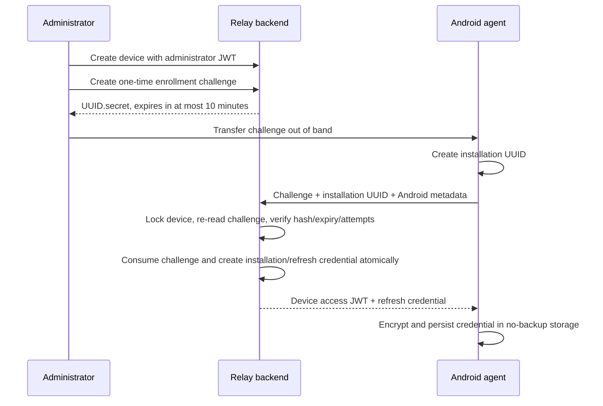

# Relay Sprint 2 delivery report

Verification date: 2026-09-02. This report describes the source and checks actually completed in this delivery. Sprint 3 is proposed in section 17 and is not implemented.

## 1. Implementation summary

Sprint 2 adds a real Kotlin/Jetpack Compose Android agent and extends the Sprint 1 FastAPI backend with secure one-time enrollment, installation-bound device authentication, deterministic refresh rotation, revocation, versioned generic configuration, delivery-gated acknowledgement, and minimal heartbeat/contact state.

Administrator authentication remains the Sprint 1 email/password and administrator JWT flow. Android never receives administrator credentials. No collector, ingestion API, SMS/notification/media access, OCR, AI, banking rule, payment parser, or dashboard was added.

## 2. Full changed repository tree

This is the complete added/modified tree relative to the preserved `relay-sprint-1.zip`; no Sprint 1 file was removed. Generated caches and build directories are excluded.

```text
relay/
├── .env.example                                      [modified]
├── .github/workflows/ci.yml                         [modified]
├── README.md                                        [modified]
├── SPRINT_2_DELIVERY.md                             [added]
├── pyproject.toml                                   [modified]
├── android/                                         [added]
│   ├── .editorconfig
│   ├── .gitignore
│   ├── build.gradle.kts
│   ├── gradle.properties
│   ├── gradlew
│   ├── gradlew.bat
│   ├── settings.gradle.kts
│   ├── gradle/wrapper/
│   │   ├── gradle-wrapper.jar
│   │   └── gradle-wrapper.properties
│   └── app/
│       ├── build.gradle.kts
│       ├── proguard-rules.pro
│       └── src/
│           ├── main/
│           │   ├── AndroidManifest.xml
│           │   ├── java/com/relay/agent/
│           │   │   ├── RelayApplication.kt
│           │   │   ├── application/{AgentController.kt,RetryPolicy.kt}
│           │   │   ├── data/{ConfigurationCodec.kt,CredentialCipher.kt,CredentialCodec.kt,DataStoreAgentStore.kt,HttpRelayApi.kt,SyncScheduler.kt}
│           │   │   ├── domain/Models.kt
│           │   │   └── presentation/{AgentViewModel.kt,MainActivity.kt}
│           │   └── res/
│           │       ├── drawable/ic_relay.xml
│           │       ├── values/{strings.xml,styles.xml}
│           │       └── xml/{backup_rules.xml,data_extraction_rules.xml,network_security_config.xml}
│           ├── debug/res/xml/network_security_config.xml
│           ├── test/java/com/relay/agent/
│           │   ├── application/{AgentControllerTest.kt,RetryPolicyTest.kt}
│           │   └── data/{ConfigurationCodecTest.kt,CredentialCodecTest.kt,HttpRelayApiTest.kt}
│           └── androidTest/java/com/relay/agent/{BackendRoundTripInstrumentedTest.kt,SecureStorageInstrumentedTest.kt}
├── artifacts/                                       [added]
│   ├── README.md
│   ├── relay-agent-0.2.0-debug.apk
│   └── relay-agent-0.2.0-release-unsigned.apk
├── docs/
│   ├── sprint-2-architecture.md                     [added]
│   ├── sprint-2-emulator-evidence.json              [added]
│   ├── sprint-2-postgres-evidence.json              [added]
│   ├── sprint-2-security.md                         [added]
│   ├── sprint-2-verification-evidence.json          [added]
│   └── sprint-3-proposal.md                         [added]
├── migrations/
│   ├── env.py                                       [modified]
│   └── versions/0002_agent_foundation.py            [added]
├── src/relay/
│   ├── application/
│   │   ├── agent.py                                 [added]
│   │   ├── agent_ports.py                           [added]
│   │   └── devices.py                               [modified]
│   ├── domain/agent.py                              [added]
│   ├── infrastructure/
│   │   ├── agent_models.py                          [added]
│   │   ├── agent_repository.py                      [added]
│   │   ├── config.py                                [modified]
│   │   ├── datetime_utils.py                        [added]
│   │   ├── device_security.py                       [added]
│   │   └── repositories.py                          [modified]
│   └── presentation/
│       ├── agent_dependencies.py                    [added]
│       ├── agent_schemas.py                         [added]
│       ├── app.py                                   [modified]
│       └── routes/agents.py                         [added]
└── tests/
    ├── test_agent.py                                [added]
    ├── test_migrations.py                           [modified]
    └── test_postgres.py                             [modified]
```

## 3. Android architecture

The Android module uses Kotlin, Compose, coroutines, DataStore, WorkManager, OkHttp, and kotlinx.serialization. Its dependencies follow four boundaries:

- Domain models define state, configuration, credentials, API/store contracts, and safe outcomes.
- `AgentController` owns enrollment and serialized synchronization decisions. It persists a renewal operation ID before sending the request so process death can retry the same operation safely.
- Data adapters implement strict JSON parsing, an explicit no-redirect/no-automatic-retry HTTP client, Android Keystore AES-GCM encryption, no-backup DataStore persistence, and network-constrained WorkManager scheduling.
- Compose presents enrollment and status screens. The enrollment value is obscured, cleared after submission, and protected with `FLAG_SECURE`.

The application directly requests only `INTERNET` and `ACCESS_NETWORK_STATE`. WorkManager contributes wake/boot/foreground-service permissions. The built APK declares no SMS, contacts, call-log, notification-listener, storage/media, camera, microphone, or location permission.

## 4. Backend architecture changes

Sprint 1 boundaries remain intact. New domain values and validation live in `domain/agent.py`; enrollment/configuration/contact transactions live in `application/agent.py`; repository and token interfaces live in `application/agent_ports.py`; SQLAlchemy and device-token implementations live in infrastructure; FastAPI dependencies, schemas, and routes live in presentation.

Device disable is coordinated in the application transaction: setting a device to `DISABLED` revokes its active installation, refresh credentials, and unused challenges. Every authenticated device request verifies the access-token domain and then checks the current credential, installation, device ownership, revocation, expiry, and active device status against the database.

## 5. Enrollment flow



Challenge secrets are shown once and stored by the backend only as SHA-256 digests. A challenge is bounded to five failed attempts. Successful consumption is transactional. PostgreSQL verification launched two concurrent consumers against one challenge and proved exactly one succeeded. A current installation can be replaced only when the administrator creates a challenge with explicit replacement intent; replacement revokes the prior installation and credential family.

## 6. Authentication/credential design

Three credential domains are separate:

| Domain | Holder | Purpose | Lifetime/storage |
| --- | --- | --- | --- |
| Administrator JWT | Human/operator client | Device administration and configuration | Existing Sprint 1 audience; 15 minutes |
| Enrollment challenge | Administrator transfers once to one Android install | Bootstrap only | At most 10 minutes; hash-only database storage; single use |
| Device credentials | One installation | Configuration, ACK, heartbeat, renewal | Device access JWT 15 minutes; refresh family has a 30-day absolute expiry |

Device JWTs use audience `relay-device`, token type `device_access`, installation/device/credential identifiers, and a signing key derived in a separate HMAC domain from the configured master secret. Administrator tokens fail device endpoints and device tokens fail administrator endpoints.

Refresh values are `credential_uuid.secret`; only the secret digest is stored. Rotation requires an installation UUID and client-generated request UUID. Retrying the exact operation deterministically returns the same successor. Reusing an already-consumed refresh value with another request UUID is treated as family replay and revokes the family. Android durably stores the request UUID before transmission.

## 7. Database migrations/schema

Migration `0002_agent_foundation.py` is additive and leaves `0001_users_and_devices.py` unchanged. It creates:

- `enrollment_challenges`: device FK, hash, expiry, replacement intent, attempts, consumed/revoked timestamps.
- `device_installations`: installation/device binding, enrollment/revocation, acknowledged and reported configuration versions; a partial unique index permits one active installation per device.
- `device_credentials`: installation/device binding, hash, absolute expiry, consumption/revocation, request ID, and successor ID; a partial unique index permits one active refresh credential per installation.
- `device_configurations`: immutable `(device_id, version)` history with schema version 1 and JSON settings.
- `configuration_deliveries`: installation/device/version evidence used to authorize acknowledgements.

Every existing Sprint 1 device receives configuration v1 `{}` during upgrade. Foreign keys, checks, indexes, partial uniqueness, and the configuration composite FK were exercised on PostgreSQL. Upgrade, drift check, downgrade, re-upgrade, and a second drift check passed on a fresh PostgreSQL 16.15 cluster.

## 8. API endpoints

All endpoints retain `/api/v1` and the Sprint 1 request-ID/error envelope.

| Method | Endpoint | Auth | Result |
| --- | --- | --- | --- |
| POST | `/devices/{id}/enrollment-challenges` | Administrator | Create one-time challenge; optional explicit replacement |
| GET | `/devices/{id}/state` | Administrator | Read installation, contact, config, ACK, and credential-expiry state |
| GET | `/device-states` | Administrator | Paginated agent-state list |
| GET | `/devices/{id}/configuration` | Administrator | Read current generic configuration |
| PUT | `/devices/{id}/configuration` | Administrator | Append a configuration using `expected_version` |
| POST | `/devices/{id}/revoke` | Administrator | Revoke agent credentials and return device to pending unless disabled |
| POST | `/device/enroll` | One-time challenge | Create installation identity and initial credential bundle |
| POST | `/device/renew` | Refresh credential | Idempotently rotate the credential |
| GET | `/device/configuration?known_version=N` | Device JWT | Deliver current config or `304` after proven prior delivery |
| POST | `/device/configuration/ack` | Device JWT | ACK a configuration previously delivered to that installation |
| POST | `/device/heartbeat` | Device JWT | Report app/config version and update minimal contact state |

Sprint 1 auth, health, readiness, and device CRUD endpoints remain available. Disable remains `PATCH /devices/{id}` with `{"status":"DISABLED"}` and now revokes the agent atomically.

## 9. Configuration synchronization design

The only supported document is schema v1: `{"schema_version":1,"version":N,"settings":{...}}`. The server maintains immutable versions and uses optimistic `expected_version` writes to prevent lost administrator updates. Settings are bounded by JSON size/depth/type validation; `sync_interval_seconds`, when supplied, is limited to 900–86400 seconds.

The server records delivery before returning a document. A device may ACK only a version delivered to its current installation; a claimed `known_version` or heartbeat version does not manufacture delivery proof. ACK rollback, future versions, cross-device versions, stale administrator writes, and oversized/deep/non-finite configuration were rejected in tests.

## 10. Offline behavior

Android writes a valid configuration before acknowledging it and retains the last-known-good document when parsing, authentication, or transport fails. Periodic work requires network connectivity and uses WorkManager's bounded backoff; Android controls exact execution timing. The minimum configured periodic interval is 15 minutes.

An ambiguous enrollment submission is never automatically replayed because the challenge may have been consumed. An ambiguous renewal retries the persisted operation UUID, allowing the server to return the same successor safely. A terminal `401` clears credentials and requires enrollment while preserving last-known-good configuration for local continuity. There is no offline event queue because collection/ingestion is Sprint 3 scope.

## 11. Test results

- Backend isolated suite: **131 passed, 5 PostgreSQL-only skipped, 0 failed** in 56.35 seconds.
- Backend full PostgreSQL suite: **136 passed, 0 skipped, 0 failed** in 61.67 seconds.
- Android JVM suite: **19 passed, 0 failed** across controller state, offline/401 handling, stable renewal IDs, configuration parsing/fallback, credential encoding, HTTP behavior, and retry policy.
- Local API 35 instrumentation: **3 passed, 1 optional live test skipped**. It verified Keystore randomized authenticated encryption/tamper failure, encrypted no-backup persistence, backup policy, and permission boundaries.
- Configured API 35 emulator/backend round trip: **1 passed**. It performed enrollment, secure persistence, config retrieval/ACK, and heartbeat; backend state was ACTIVE with configuration and ACK version 1, installation identity, app version 0.2.0, and `last_seen_at`.

The optional live instrumentation case is skipped by the ordinary connected suite when no one-time test challenge is supplied. It was then executed separately with a fresh challenge and passed. Detailed machine-readable summaries are in `docs/sprint-2-verification-evidence.json`, `docs/sprint-2-postgres-evidence.json`, and `docs/sprint-2-emulator-evidence.json`.

## 12. PostgreSQL integration results

PostgreSQL 16.15 ran as a fresh disposable cluster. Migration upgrade/check/downgrade/re-upgrade/check all passed. Ten live Uvicorn checks passed against PostgreSQL, including liveness, database readiness, protected rejection, administrator login/identity, and device create/conflict/read/disable/list.

Five PostgreSQL-specific tests passed: timezone/uniqueness behavior, concurrent duplicate insert, concurrent single-use enrollment, concurrent disjoint-field update preservation, and database status constraints. The cluster was stopped after verification.

## 13. Android build/test/lint results

Final local toolchain: JDK 21, Gradle 8.13, Android compile/target SDK 36, min SDK 26, and API 35 emulator.

`ktlintCheck`, `testDebugUnitTest`, `lintDebug`, `lintRelease`, `assembleDebug`, `assembleDebugAndroidTest`, and minified `assembleRelease` passed together: **BUILD SUCCESSFUL in 2m 52s; 146 actionable tasks**. The APK permission dump contains network access plus WorkManager operational permissions and no personal-content permission.

The debug APK is development-signed and the release APK is intentionally unsigned. Their SHA-256 hashes and handling notes are in `artifacts/README.md`.

## 14. Backend quality results

- Black: passed; 54 Python files unchanged after formatting.
- Ruff: passed with the configured E/F/I/UP/B/ASYNC rules.
- strict MyPy: passed for 38 source files.
- Pytest: passed as reported in sections 11 and 12.
- Alembic drift and migration roundtrip: passed on PostgreSQL.
- Live PostgreSQL API smoke: 10/10 passed.

The GitHub Actions workflow retains backend checks and adds a separate Android JDK 21/SDK 36 job for Kotlin format, unit tests, debug/release lint, and debug/release builds. The workflow was reviewed locally; it was not executed on GitHub in this delivery.

## 15. Security review

Verified controls include distinct admin/enrollment/device trust domains; hash-only enrollment and refresh storage; short-lived access tokens; absolute refresh expiry; rotation/replay response; transaction locks and database constraints; immediate future-request denial after disable/revoke; installation/device binding on every request; delivery-gated ACK; bounded inputs; safe generic errors; request correlation; no HTTP redirects or silent HTTP retry; HTTPS-only release endpoints; no trust-all TLS; Keystore AES-GCM with randomized IVs; backup exclusion; secret-obscured UI; and no personal-data permissions or collectors.

Threat-focused tests cover invalid, expired, replayed, malformed, revoked, cross-domain, and cross-device credentials/configuration; challenge attempt limits and concurrent consumption; credential hashes at rest; log/error redaction; disable and re-enrollment; invalid configuration; and Keystore tamper failure.

This review did not perform third-party dependency vulnerability scanning, penetration testing, hardware-backed key attestation, certificate pinning, rooted-device analysis, or production infrastructure review. Those are not claimed.

## 16. Known limitations

- The release APK is unsigned and no application was deployed or published. Production endpoint, signing, secret rotation, TLS termination, monitoring, backups, and rate limiting remain operator work.
- The emulator round trip used API 35 and SQLite for its temporary transport backend; PostgreSQL behavior was separately verified with the complete backend suite and live API probes. No physical-device or multi-OEM matrix was executed.
- Android Keystore protects credentials from normal file extraction but does not establish hardware attestation or defend a fully compromised/rooted OS.
- There is no certificate pinning. Release traffic requires platform-trusted HTTPS.
- The 30-day refresh lifetime is absolute. An installation that cannot renew before expiry must enroll again.
- WorkManager timing is OS-controlled; a 15-minute period is a minimum request, not a real-time guarantee.
- Configuration schema v1 is generic and deliberately contains no collector or arbitrary-command capability.
- GitHub CI configuration was added but not run on GitHub. The local Android command emitted a non-fatal SDK XML reader-version warning and still completed all requested tasks successfully.

## 17. Exact Sprint 3 proposal

Sprint 3 should introduce **one explicitly approved local collector and a durable, idempotent event ingestion pipeline** on the Sprint 2 identity/configuration foundation. Before implementation, the product owner must approve the source, distribution constraints, user consent and OS permission flow, allowable fields, payload and offline-backlog bounds, local/server retention, erasure/revocation policy, and abuse/rate controls.

The implementation should then add: a narrow consent-aware collector adapter; a versioned generic event envelope; a crash-safe encrypted Android outbox with quotas and bounded backoff; authenticated installation-bound batch ingestion with per-item outcomes; PostgreSQL idempotency and durable raw-event/processing state; configuration that cannot override local consent; retention/erasure operations; and tests for offline recovery, lost responses, duplicate/concurrent submissions, isolation, revocation, malformed/oversize events, permission withdrawal, disk/key failure, and log redaction.

Sprint 3 must still exclude AI, OCR, banking/payment rules, arbitrary downloaded code/commands, and every unapproved personal-content source. The full proposal and acceptance gates are in `docs/sprint-3-proposal.md`. No part of this proposal is implemented in Sprint 2.
