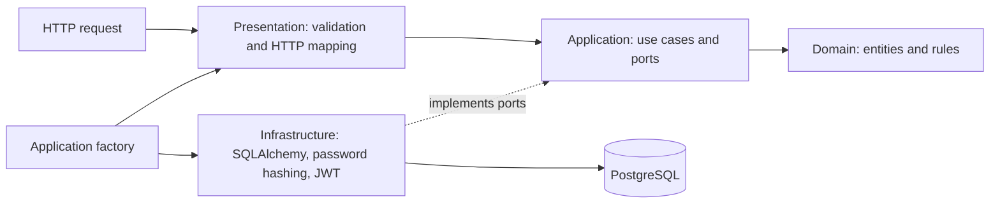

# Sprint 1 architecture and decisions

Relay is a generic backend foundation for a future data collection platform. Its runtime has no AI dependency, no source-specific parser, and no collector dependency. The next client can be an Android device without turning device identity into a phone number or tying the platform to a messaging/payment provider.

## Boundaries

The arrows describe dependencies and wiring, not a requirement that the domain call a framework. Domain entities are ordinary typed Python objects. Application operations depend on interfaces; SQLAlchemy and security libraries remain behind infrastructure adapters. Presentation owns JSON schemas, HTTP status codes, request correlation, and dependency injection. The application factory owns composition and lifecycle, not business orchestration.

The structure deliberately starts with four layers and focused feature modules rather than a plugin framework, generic event bus, or universal repository abstraction. Future Devices, Collectors, Rules, Events, Processing, Transactions, and Reporting modules can add their own focused types and use cases within the same boundaries. No empty runtime modules or speculative processors are needed now.

## Main flows

**Login:** validate the JSON input; find the normalized administrator account; verify the password hash through a security port; reject invalid credentials with a safe response; issue a bounded-lifetime JWT with the expected issuer and audience. The client receives a token, its bearer type, and expiry duration, never a password hash.

**Authenticated request:** validate the JWT and expected claims, load the current administrator, reject an absent or disabled user, then invoke the device or current-user use case. This database lookup makes administrator disabling effective for previously issued tokens on subsequent requests. It is not an individual token denylist.

**Create/update device:** validate external input in presentation and enforce invariants in the domain/application boundary; use a request-scoped database session; persist through a repository; return the typed result. The unique database constraint on the external identifier is the final authority when requests race. A duplicate becomes a conflict rather than an unhandled database error.

**Readiness:** perform a bounded database connectivity check and return a sanitized readiness result. A successful liveness check is independent of database access. Neither endpoint performs migrations, provisions accounts, or mutates business records.

## Persistence model

| Table / concept | Fields | Constraints and ownership |
| --- | --- | --- |
| Users | UUID `id`; `email`; `password_hash`; `is_active`; `created_at` | Normalized unique email; hash only; no public account creation |
| Devices | UUID `id`; `external_device_id`; `name`; `platform`; nullable `app_version`; `status`; `created_at`; `updated_at`; nullable `last_seen_at` | Unique case-sensitive external ID; constrained status; timestamps and ID server-owned |

There is no user-device ownership foreign key in Sprint 1: the system has a single administration boundary and all active administrators see all devices. This is a deliberate limit, not implicit multi-tenancy. Before adding tenant isolation, define ownership, authorization, query scoping, and migration semantics explicitly.

The database status set is `PENDING`, `ACTIVE`, and `DISABLED`. Domain code uses an enum rather than arbitrary status strings. `last_seen_at` is reserved for a real device contact protocol and remains null now. No endpoint manufactures device activity timestamps to imply an enrolled connection exists.

SQLAlchemy models are separate from the domain. Async sessions are scoped to operations/requests and released afterward; the application lifespan manages the engine. Pool configuration is environment-driven. PostgreSQL is the supported runtime database. SQLite is a fast isolated test substitute only, so CI also targets PostgreSQL for migration and persistence behavior.

Alembic is the schema authority. The initial revision creates the Sprint 1 tables and constraints. Runtime startup does not call `create_all` or automatically run upgrades. A deployment operator must apply reviewed migrations once before starting workers. Downgrading the initial migration drops data and is restricted to disposable verification or an explicitly reviewed recovery operation.

## Important design decisions

| Decision | Rationale | Limit / future change |
| --- | --- | --- |
| Separate domain and ORM types | Domain tests do not require SQLAlchemy; database changes do not define business entities | Mapping is explicit and modest in Sprint 1 |
| Ports for persistence and security | Use cases can be tested with controlled collaborators and adapters replaced independently | No speculative generic plugin registry |
| Asynchronous database access | Fits FastAPI's asynchronous request lifecycle | Pool and database limits still bound capacity |
| Short-lived HS256 administrator JWTs | Small, explicit authentication foundation with an algorithm allowlist and secret from the environment | No refresh flow, key ring, or token denylist yet |
| Active-user lookup for protected requests | Administrator disabling is enforced after token issuance | Adds a database dependency to each authenticated request |
| Interactive administrator CLI | Avoids a default password or unauthenticated bootstrap endpoint | Operators require trusted runtime/database access |
| Device external ID separate from phone number | Supports generic devices and multiple future sources | Enrollment proof and hardware identity are Sprint 2 decisions |
| Immutable external ID/platform in PATCH | Prevents identity changes through a metadata edit endpoint | A future migration/re-enrollment operation must be explicit |
| Status update instead of DELETE | Preserves device records while allowing administrative disabling | Retention/erasure policies need their own design later |
| Bounded offset pagination without total | Straightforward contract with capped work per page | Cursor pagination/search can follow evidence of scale |
| Explicit migrations | Avoids workers racing schema changes during startup | Release orchestration is intentionally not supplied |
| No CORS origins by default | Prevents accidental cross-origin browser access | Browser clients must be allowlisted when introduced |
| Sanitized errors and structured logs | Operators can correlate requests without exposing payloads or stack traces to clients | Central log retention and access controls are deployment concerns |

## Security boundary

The JWT signing secret and database URL are required secrets, not built-in defaults. Production settings reject unsafe configurations such as wildcard browser origins and development-only hosts. Secret-bearing configuration validation must not echo input values. Validating settings does not certify the surrounding deployment or protect a compromised host.

The HTTP surface validates request schemas, parameter bounds, and device identifiers. ORM queries use bound parameters. Unexpected exceptions become safe structured errors rather than stack traces. Request IDs are correlation data, never authorization data; treat even a syntactically valid incoming ID as untrusted and do not put secrets into it.

The supplied container runs as a non-root user. Compose keeps published database/backend ports on loopback, drops backend capabilities, and uses a read-only backend filesystem. PostgreSQL state lives in a persistent named volume. These are local safety measures, not a production deployment topology.

TLS, credential-abuse rate limiting, request-size limits, proxy trust, external access logs, backups, secret rotation, and production database privileges must be addressed before public exposure. The backend currently has no device credentials or collector ingress; administrator tokens must not be installed in a future Android client.

## Verification expectations

The isolated suite should exercise health/readiness, valid and invalid authentication, protected-route rejection, active-user enforcement, current-user serialization, device validation, create/list/get/update behavior, duplicates, safe errors, and request correlation. PostgreSQL tests verify behavior that SQLite cannot establish. The migration check verifies both schema creation and drift detection against PostgreSQL.

Ruff, Black, MyPy, and Pytest are configured centrally in `pyproject.toml` and run in CI. The delivery verification report, rather than this architectural intent, is the authority for observed check results and unverified areas. No deployment or public exposure is part of Sprint 1.
