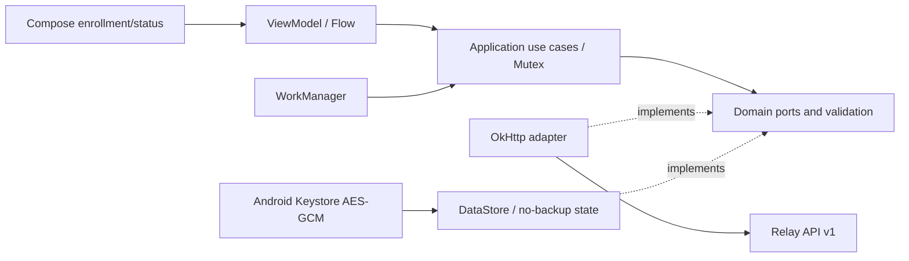

# Sprint 2 architecture and API contract

Relay adds a lightweight Android agent and the backend protocol it needs for enrollment, authentication, lifecycle, configuration, and contact. The server owns effective configuration and access policy. The client validates and persists inert configuration; it does not implement data collection or execute commands. AI is not a dependency.

The [Sprint 1 architecture](architecture.md) is preserved. Its dependency direction and administrator API remain the foundation. [Sprint 2 delivery](../SPRINT_2_DELIVERY.md) is the authority for executed verification; the flows below describe the implemented contract, not runtime evidence.

## Android architecture

One `app` module uses packages for separation, without speculative feature modules:

| Layer | Responsibilities |
| --- | --- |
| Domain | Installation/enrollment state, token bundle, configuration validation, retry decisions, and persistence/network ports. No Android UI or server business rules. |
| Application | Serialized enrollment, renewal, and synchronization use cases; last-known-good application; acknowledgement ordering; observable state. |
| Data/infrastructure | OkHttp requests, JSON mapping, DataStore state, Android Keystore AES/GCM protection, WorkManager scheduling, clock/network adapters. |
| Presentation | Compose Material 3 enrollment and status views with a ViewModel/Flow boundary; progress, safe failures, and manual synchronization. |



A fresh installation creates a random UUID, not a phone number, IMEI, serial number, advertising ID, or account identity. All installation state lives under no-backup storage and is excluded from cloud and device-transfer backup. Reinstallation creates a new identity. The app protects its credential bundle with a nonexportable Android Keystore AES key and random-IV authenticated encryption. Sensitive classes do not expose tokens through ordinary string representations.

An app-level coroutine mutex serializes enrollment, foreground/manual sync, background sync, and renewal. Network work does not block the main thread. Enrollment input is obscured and cleared after submission. The minimal status UI shows connection/enrollment state, name and identifier, configuration version, app version, and last successful synchronization. There are no collector screens or personal-content permissions.

WorkManager uses connected-network constraints and a periodic interval of at least 15 minutes. The benign optional `settings.sync_interval_seconds` may request 900–86400 seconds; OS scheduling is approximate, not a real-time guarantee. Retries are bounded per cycle; later scheduled cycles can recover after a temporary outage.

## Backend changes

New domain values and application ports/use cases cover challenges, installations, credentials, configuration, and device state. Infrastructure implements hashes/JWTs and transaction-scoped persistence. Presentation retains FastAPI validation, safe errors, and `X-Request-ID`; it wires separate administrator and device dependencies. ORM types stay outside the domain, and device routes derive identity from authenticated claims rather than caller-selected device IDs.

The administrator JWT adapter is unchanged. The device token adapter derives a separate signing key with HMAC-SHA256 domain separation from the server secret and a fixed device-access label. It uses audience `relay-device` and `token_type=device_access`. Device access claims include installation subject, device ID, credential ID, issuer, audience, issue/not-before/expiry times, and token ID. Every authenticated operation rechecks device, installation, and credential status in the database. A previously issued token does not bypass disabling, revocation, or credential rotation.

## Identity and lifecycle

| Concept | Meaning |
| --- | --- |
| Device record | Administrator-managed backend UUID, external identifier, name, platform, and lifecycle status. Preserved across re-enrollment. |
| Installation identity | Random UUID generated by one app installation, independently of hardware or phone number. |
| Enrollment | One-time proof that an operator authorized a particular installation to bind to a device. |
| Device credential | Expiring authorization bound to that device and installation; access token plus rotating refresh credential. |

`PENDING` records exist before enrollment; successful enrollment activates the device. `ACTIVE` is necessary but not sufficient for access: the current installation and credential must also be valid. `DISABLED` blocks enrollment, device authentication, configuration, acknowledgement, heartbeat, and renewal. Administrator management remains available for disabled records.

`PATCH /api/v1/devices/{device_id}` with `{"status":"DISABLED"}` revokes installation credentials in the same operation. Setting `ACTIVE` later cannot restore them. Explicit revocation ends device authorization without deleting identity history. To replace an existing enrollment, the administrator issues a challenge with `replace_existing:true`; successful enrollment revokes the previous installation and credential family transactionally. Merely issuing a replacement challenge does not switch the device. Historic installations, consumed challenges, and credential state are retained.

## Enrollment flow

```mermaid
sequenceDiagram
    actor Admin
    participant Backend
    participant DB as PostgreSQL
    participant App as Android installation
    Admin->>Backend: Admin JWT + create challenge for device
    Backend->>DB: Store secret digest, binding, expiry, attempts
    Backend-->>Admin: One-time challenge + challenge ID + expiry
    Admin->>App: Transfer challenge through trusted channel
    App->>App: Load/create installation UUID
    App->>Backend: Challenge + installation + app metadata
    Backend->>DB: Lock and validate device/challenge; atomically consume
    Backend->>DB: Bind installation, revoke replaced credentials, store refresh digest
    Backend-->>App: Short-lived device access + rotating refresh credential
    App->>App: Encrypt and atomically persist credential bundle
```

Challenges are cryptographically random `uuid.secret` values, default to ten minutes, allow at most five wrong-secret attempts, and are bound to the administrator-selected device. Consuming a challenge and creating enrollment/credentials share one transaction. Incorrect-secret attempts persist even though authentication returns an error. Concurrent submissions cannot both consume the same challenge. Expired, consumed, invalid, and locked challenges receive a generic `401`; malformed JSON/schema receives `422`.

The app never installs an administrator JWT. Enrollment is not automatically replayed after an uncertain network outcome: the backend may already have consumed the one-time value. The app asks for a fresh operator-issued code; if the prior operation enrolled successfully on the server, the operator must use explicit replacement.

## Authentication and renewal

Device access defaults to 15 minutes. Refresh authorization expires after an absolute 30-day lifetime from enrollment, even across rotations. Refresh values contain a credential UUID plus a 256-bit random secret; only SHA-256 digests are stored. No permanent bearer token or plaintext refresh secret is stored in PostgreSQL.

Before renewal, the app persists a fresh request UUID alongside the existing encrypted refresh credential. A successful renewal consumes the old credential and issues its successor. The server can recover the same successor secret deterministically with a domain-separated HMAC over the presented prior secret and request ID; it stores the successor digest, not the plaintext. A retry using the same operation ID and correct old secret returns the same still-active successor. It does not extend absolute expiry. A different request ID replay of a consumed credential revokes the installation's active credential family. Retries fail if the device, installation, old family, or successor is invalid, disabled, revoked, or expired.

This handles a lost renewal response without creating a second live family or requiring plaintext secret storage. The app preserves the pending operation across process restarts and replaces the encrypted bundle atomically on success. Access tied to the consumed credential no longer authenticates. The next device `401` permits at most one coordinated renewal attempt; persistent authentication rejection moves the app to enrollment-required state.

## Configuration synchronization and offline behavior

Configuration starts at version 1, schema version 1, with empty settings. Updates increase the per-device version and retain revision history. Administrator writes include `expected_version`; a stale writer receives `409` instead of overwriting a concurrent change. JSON sizes, depth, types, and supported setting values are bounded. Other generic JSON settings are inert data: no key starts a collector or executes code in Sprint 2.

```mermaid
sequenceDiagram
    participant App
    participant Local as Local no-backup store
    participant API as Device API
    App->>Local: Load last-known-good config and credentials
    alt Offline
        App-->>App: Display persisted config and offline state
    else Connected
        App->>API: GET configuration?known_version=N + device bearer
        alt New configuration
            API-->>App: Schema + newer version + settings
            App->>App: Validate schema, types, bounds, version
            App->>Local: Atomically save complete valid config
            App->>API: POST acknowledgement of persisted version
        else Unchanged
            API-->>App: 304 (empty body)
            App->>API: Retry pending acknowledgement if needed
        else Invalid document
            App-->>App: Retain last-known-good; report safe failure
        end
        App->>API: Authenticated heartbeat with app/config version
        API-->>App: Server contact and acknowledgement state
        App->>Local: Save successful-sync state after success
    end
```

The client validates schema 1, positive nondecreasing version, settings object, JSON bounds, and known settings before application. Invalid JSON, unknown schema, invalid setting, or rollback never destroys the last-known-good document. Persistence succeeds before acknowledgement. A failed acknowledgement leaves the valid document intact and is retried on a subsequent sync. Backend acknowledgement must reference a revision delivered to the current installation; future, unserved, or backwards acknowledgements fail with `409`. Repeating the current acknowledgement is idempotent. Claiming a known version is not proof of delivery.

Offline startup immediately loads persisted state, including last successful sync. It does not fabricate a successful network contact or erase the configuration. IOException/offline, `408`, `429`, and `5xx` are retryable with bounded exponential backoff (maximum five retries per cycle). Other `4xx` and invalid configuration are nonretryable for that operation; `401` uses the bounded renewal path. OkHttp automatic connection retry and redirects are disabled, explicit timeouts bound calls, and no HTTP logging interceptor records tokens or payloads.

## Contact tracking

Only valid authenticated device contact contributes to server-owned `last_seen_at`. Unchanged contact writes are coalesced with a default 60-second window. Changed app/configuration metadata is retained without waiting for that window. Therefore `last_seen_at` may lag a request by up to the coalescing window; it is not a network-presence guarantee. Invalid authentication never manufactures contact.

The administrator state view reports device/status, current installation, enrollment time, last contact, app version, effective configuration version, acknowledged version, and credential expiry. It does not expose credential/challenge hashes, tokens, phone numbers, location, hardware identifiers, personal content, or invasive telemetry.

## Database and migrations

Sprint 1 revision `0001` remains unchanged. Sprint 2 adds revision `0002`; an upgrade preserves users, device IDs, statuses, and existing device behavior. New persistence represents:

| Entity | Stored state / constraints |
| --- | --- |
| Enrollment challenges | UUID, device foreign key, secret digest, expiration, attempt counter/limit, consumed state, replacement authorization. |
| Installations | Installation UUID, device foreign key, enrolled/revoked state and times, app/contact metadata, delivery/acknowledgement state. Only one active installation per device. |
| Device credentials | Credential UUID, installation binding, secret digest, creation/absolute expiry, consumed/revoked state, renewal request ID, successor relationship. |
| Device configurations | Device-scoped current version/schema and JSON settings; positive version constraints. |
| Configuration history | Device and version uniqueness; retained valid document needed to verify delivered/applied revisions. |

Foreign keys and uniqueness constraints provide final database authority. Mutations lock the device before its challenge/credential state to coordinate enrollment, disable/revoke, renewal, and configuration changes. Conditional/locked consumption and version checks protect races; transaction cleanup must not erase failed attempt accounting. The PostgreSQL-specific suite is required because SQLite cannot establish production row-lock behavior.

Run `alembic upgrade head` explicitly before workers start and `alembic check` to detect schema drift. Do not edit `0001` or use runtime `create_all`. On a populated system, back up first and review rollback implications: downgrading to `0001` discards new enrollment/configuration/security history; downgrading to base removes all tables. Migration roundtrips are only a disposable verification procedure.

## API endpoints and examples

All examples are inert; angle-bracket placeholders are not usable credentials. Keep live credentials out of shell history and logs. JSON uses snake_case. Authentication errors use the Sprint 1 safe error envelope and `X-Request-ID`. Existing health/auth/device CRUD routes remain available.

| Method | `/api/v1` path | Access | Result |
| --- | --- | --- | --- |
| POST | `/devices/{device_id}/enrollment-challenges` | Administrator bearer | `201` challenge, ID, binding, expiry |
| GET | `/devices/{device_id}/state` | Administrator bearer | `200` enrollment/contact/configuration state |
| GET | `/device-states?limit=20&offset=0` | Administrator bearer | `200` items/limit/offset |
| GET | `/devices/{device_id}/configuration` | Administrator bearer | `200` current configuration |
| PUT | `/devices/{device_id}/configuration` | Administrator bearer | `200` new revision; `409` stale expected version |
| POST | `/devices/{device_id}/revoke` | Administrator bearer | `200` revoked authorization; history retained |
| PATCH | `/devices/{device_id}` | Administrator bearer | Existing route; `DISABLED` now also revokes credentials |
| POST | `/device/enroll` | Challenge in body | `201` installation-bound credential bundle |
| POST | `/device/renew` | Refresh credential in body | `200` rotated/recovered credential bundle |
| GET | `/device/configuration?known_version=N` | Device bearer | `200` document; `304` empty if unchanged; `409` ahead of server |
| POST | `/device/configuration/ack` | Device bearer | `200` acknowledged version; `409` invalid revision |
| POST | `/device/heartbeat` | Device bearer | `200` safe contact/configuration state |

Create a challenge (`replace_existing` must be explicit for replacing an enrolled installation):

```json
{"replace_existing": false}
```

```json
{
  "challenge_id": "<challenge-uuid>",
  "challenge": "<challenge-uuid>.<one-time-secret>",
  "device_id": "<device-uuid>",
  "expires_at": "<UTC ISO8601 expiration>"
}
```

Android enrollment request:

```json
{
  "challenge": "<challenge-uuid>.<one-time-secret>",
  "installation_id": "<fresh-installation-uuid>",
  "name": "Lab Android installation",
  "platform": "android",
  "app_version": "<installed-app-version>"
}
```

The installation platform must match the device record. Client metadata does not replace the administrator-owned device external ID or silently rename the device. Successful enrollment/renewal response:

```json
{
  "device_id": "<device-uuid>",
  "installation_id": "<installation-uuid>",
  "device_name": "Lab device 01",
  "access_token": "<short-lived-device-jwt>",
  "token_type": "bearer",
  "expires_in": 900,
  "refresh_token": "<credential-uuid>.<refresh-secret>",
  "refresh_expires_at": "<UTC ISO8601 absolute expiration>"
}
```

Renewal request (retain this operation's `request_id` across retries):

```json
{
  "refresh_token": "<credential-uuid>.<refresh-secret>",
  "installation_id": "<installation-uuid>",
  "request_id": "<persisted-renewal-operation-uuid>"
}
```

Administrator configuration write and resulting document:

```json
{"expected_version": 1, "schema_version": 1, "settings": {"sync_interval_seconds": 900}}
```

```json
{"schema_version": 1, "version": 2, "settings": {"sync_interval_seconds": 900}}
```

On first device retrieval omit `known_version` or use zero. Subsequent retrieval sends the locally persisted version. The device acknowledgement request is `{"version":2}` and successful response is `{"acknowledged_version":2}`. The caller cannot select another device in these requests.

Heartbeat request and response:

```json
{"app_version":"<installed-app-version>","current_config_version":2}
```

```json
{
  "status": "ok",
  "last_seen_at": "<server UTC ISO8601 contact time>",
  "configuration_version": 2,
  "acknowledged_version": 2
}
```

Administrator device state (unenrolled/unknown fields may be null):

```json
{
  "device_id": "<device-uuid>",
  "name": "Lab device 01",
  "external_device_id": "device-lab-01",
  "status": "ACTIVE",
  "installation_id": "<installation-uuid>",
  "enrolled_at": "<UTC ISO8601 enrollment time>",
  "last_seen_at": "<UTC ISO8601 contact time>",
  "app_version": "<installed-app-version>",
  "configuration_version": 2,
  "acknowledged_version": 2,
  "credential_expires_at": "<UTC ISO8601 absolute expiration>"
}
```

Errors preserve `{"error":{"code":"<stable-code>","message":"<safe-message>","request_id":"<request-id>"}}`. Never put a token in the request ID. `401` signals rejected credentials, `422` malformed input, `404` missing administrator-addressable resources, and `409` lifecycle/version conflicts. A disabled device's stale bearer/refresh does not gain a separate privileged view through detailed errors.

## Boundaries retained for Sprint 3

The framework can carry future configuration without changing the authentication protocol, but no collector implementation or collector-specific schema exists now. The [Sprint 3 proposal](sprint-3-proposal.md) describes future permission-gated collection and durable ingestion only; it does not authorize or implement personal-content access in this sprint.
