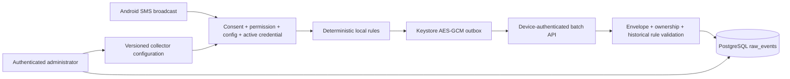

# Relay threat model

## Overview

Relay is a self-hosted FastAPI/PostgreSQL service with an Android device agent. In Sprint 3, Android receives only new SMS broadcasts, evaluates a signed-in device's last valid declarative configuration locally, encrypts matching event payloads into a bounded SQLite outbox, and sends bounded batches over the existing authenticated device channel. Administrators use a separate bearer-token trust domain to configure devices and inspect or delete raw events. The server validates the installation, current credential and active device before ingestion, revalidates the historical configuration and rule that authorized capture, and stores collector payloads separately as raw events.

| Component | Security role and evidence |
|---|---|
| Android permission/UI | Declares only `RECEIVE_SMS` for personal content and makes consent plus the runtime permission explicit user actions (`android/app/src/main/AndroidManifest.xml:5`, `android/app/src/main/java/com/relay/agent/presentation/MainActivity.kt:60-118`). |
| SMS adapter and collector | The receiver accepts the protected new-message broadcast; the collector requires consent, permission, credentials, a valid configuration and remote enablement before matching (`android/app/src/main/AndroidManifest.xml:24-29`, `android/app/src/main/java/com/relay/agent/application/SmsCollector.kt:22-72`). |
| Local outbox | AES-GCM ciphertext is stored in no-backup SQLite with count, byte and age bounds (`android/app/src/main/java/com/relay/agent/data/CredentialCipher.kt:18-55`, `android/app/src/main/java/com/relay/agent/data/EncryptedSqliteOutbox.kt:50-84`, `android/app/src/main/java/com/relay/agent/data/EncryptedSqliteOutbox.kt:207-211`). |
| Device network client | Release traffic requires HTTPS; debug cleartext is restricted to loopback aliases and event requests are capped at 14 KiB (`android/app/src/main/java/com/relay/agent/data/HttpRelayApi.kt:25-34`, `android/app/src/main/java/com/relay/agent/data/HttpRelayApi.kt:94-135`). |
| Backend ingestion | Device authentication rechecks active device, credential and installation state; ingestion binds each event to the authenticated installation and configured rule (`src/relay/application/agent.py:286-310`, `src/relay/application/events.py:38-84`). |
| Raw persistence/admin | PostgreSQL uniqueness provides idempotency and expiry is indexed; all HTTP responses are no-store and event reads/deletion require admin authentication (`migrations/versions/0003_raw_events.py:20-64`, `src/relay/presentation/middleware.py:55-62`, `src/relay/presentation/routes/events.py:19-27`). |

## Threat Model, Trust Boundaries, and Assumptions

Protected assets are SMS sender/body content, Android Keystore keys, device access and refresh credentials, administrator credentials, installation ownership, configuration integrity, event idempotency, PostgreSQL availability, and deletion/retention guarantees.

The main trust boundaries are: Android OS to the protected broadcast receiver; user to the explicit consent and permission UI; administrator-authored JSON to both bounded configuration parsers; plaintext SMS to the local AES-GCM boundary; Android to the HTTPS device API; device bearer claims to database-backed active-device authorization; and administrator bearer claims to raw-content APIs. A server operator or valid administrator is already authorized to view stored raw content and is outside the unprivileged attacker model.

Realistic attackers include an untrusted Android app attempting to spoof a broadcast, a network attacker without trusted TLS termination, a holder of a stolen device token, a compromised enrolled device submitting crafted JSON, and an unauthenticated or device-authenticated caller attempting administrator endpoints. They do not initially control an administrator account, Android system signing permission, the app UID/Keystore, the database, or trusted configuration publication.

Security objectives are: local denial always blocks new capture; remote configuration can narrow but never bypass local consent; no historical inbox read occurs; no plaintext payload enters logs or local persistence; authenticated devices cannot impersonate another installation; disabled, expired or revoked credentials cannot ingest; batches and payloads remain bounded; retries are idempotent under concurrency; raw content expires or can be deleted; and no downloaded code or regular expressions execute.

Assumptions and limits: Android Keystore protects keys from ordinary app/file access but does not guarantee confidentiality on a rooted, instrumented, or unlocked compromised device. Backend request-rate limiting is expected at the deployment edge; the repository itself bounds request and retention size but does not implement a shared distributed rate limiter. Retention removal requires the operator to schedule the provided maintenance command. Administrators and database operators can access plaintext server-side raw events. SMS delivery behavior depends on Android/OEM support for `SMS_RECEIVED`.

## Attack Surface, Mitigations, and Attacker Stories

| Priority | Scenario and capability gain | Prerequisites | Impact | Existing controls | Mitigation | Evidence |
|---|---|---|---|---|---|---|
| High hypothesis | A stolen current device token submits arbitrary matching SMS events. | Valid unrevoked credential and knowledge of an enabled historical rule. | Raw-event integrity and database consumption. | Active credential/installation checks, 16 KiB request cap, 20-item batch, schema/time/rule validation, uniqueness and retention. | Revoke/disable promptly; deploy per-device gateway limits and alert on volume. | `src/relay/application/agent.py:286-310`; `src/relay/domain/events.py:70-143`. |
| High hypothesis | Malicious configuration broadens collection unexpectedly. | Administrator account compromise or operator error. | Excess SMS collection on consenting devices. | Strict declarative schema, no regex/scripts, maximum 20 rules; local consent and permission remain mandatory. | Protect admin accounts and review config changes; add approval/audit workflow in a later sprint. | `src/relay/domain/agent.py:27-98`; `android/app/src/main/java/com/relay/agent/data/ConfigurationCodec.kt:43-111`. |
| Medium hypothesis | Local database files are copied from a lost device. | File-system access without app/Keystore execution. | Metadata exposure; SMS content remains encrypted. | AES-GCM with non-exported Android Keystore key, fresh IV, no-backup directory. | Use device encryption and remote OS controls; document rooted-device limit. | `android/app/src/main/java/com/relay/agent/data/CredentialCipher.kt:18-55`; `android/app/src/main/java/com/relay/agent/RelayApplication.kt:30-35`. |
| Medium hypothesis | Repeated authenticated requests consume PostgreSQL storage/CPU. | Valid compromised device credential. | Service degradation until revocation/retention. | Authentication, strict request/event/batch limits, indexed expiry, 30-day default retention. | Enforce shared per-device rate/volume quotas at deployment edge and monitor accepted counts. | `src/relay/presentation/middleware.py:28-83`; `src/relay/infrastructure/config.py:31`; `src/relay/infrastructure/logging.py:11-57`. |
| Low hypothesis | Another Android app forges an SMS intent. | Ability to send broadcasts but not hold the system `BROADCAST_SMS` permission. | Attempted false capture. | Exported receiver is protected by the system signature permission and validates the action. | Keep receiver permission and test merged manifest. | `android/app/src/main/AndroidManifest.xml:23-29`; `android/app/src/main/java/com/relay/agent/data/SmsReceiver.kt:13-31`. |
| Low hypothesis | Duplicate/lost responses create multiple server records. | Network interruption or concurrent resubmission. | Duplicate raw events. | Stable event IDs, database unique key, savepoint conflict handling, accepted/duplicate results. | Retain PostgreSQL concurrency regression. | `migrations/versions/0003_raw_events.py:44-48`; `src/relay/infrastructure/event_repository.py:38-87`. |

These are threat hypotheses used to guide review, not confirmed vulnerabilities.

## Severity Calibration (Critical, High, Medium, Low)

- **Critical:** an unauthenticated path to bulk SMS disclosure, administrator takeover, remote code execution, or cross-installation ingestion at scale.
- **High:** a practical authorization bypass exposing another device's SMS, bypass of explicit local consent, plaintext credential/content persistence, or remote configuration that executes code.
- **Medium:** an authenticated compromised device can materially exhaust shared storage without deployment rate controls, or a local attacker gains SMS content despite ordinary Android sandbox protections.
- **Low:** narrowly scoped metadata exposure, bounded self-device availability effects, or defense-in-depth gaps requiring an already privileged local position.
- Findings are lowered or rejected when Android signature permissions, database-backed revocation, strict schema/size bounds, parameterized SQLAlchemy queries, AES-GCM, and no-store/no-payload logging directly block the attack. Root compromise, administrator compromise, and absent deployment-edge rate limiting remain explicit assumptions or follow-up items rather than proof of an implementation vulnerability.

Repository: C:\Users\pc\Documents\Codex\2026-08-31\files-pasted-by-the-user-you\work\sprint3-security-repo
Version: sprint2-a7ae986888d842e9e45b224480edf8f9413ee8b1-to-patch-sha256-dbcea58cd747ce0883918d2913b1c168aac8303e07564594454778df0e44984f
